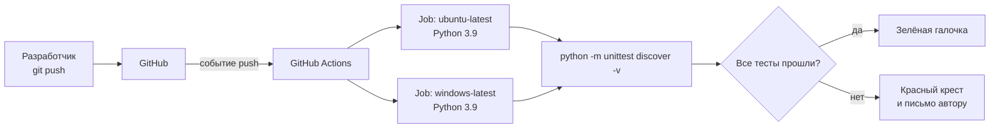

# Лабораторная работа №5. Знакомство с CI/CD

**Проект:** Geometric Lib
**Репозиторий:** https://github.com/P1NKCHEEKS/geometric_lib
**Инструмент CI:** GitHub Actions
**Автор:** [ФИО], группа [номер группы]

---

## 1. Цель работы

Настроить непрерывную интеграцию (CI) для проекта с unit-тестами: после каждого
`push` GitHub Actions должен автоматически запускать тесты из лабораторной работы
№4 на двух runner'ах — `ubuntu-latest` и `windows-latest`.

## 2. Что такое CI/CD

**CI (Continuous Integration, непрерывная интеграция)** — практика, при которой
изменения кода регулярно вливаются в общую ветку, а каждое изменение автоматически
собирается и проверяется тестами. Цель — находить ошибки сразу после коммита, а не
перед релизом.

**CD (Continuous Delivery / Continuous Deployment)** — следующий шаг: автоматическая
доставка проверенной сборки в тестовую среду (Delivery) или сразу в production
(Deployment).

В данной работе реализована именно **CI-часть**: автоматический запуск тестов на
каждый push. Сборка как таковая не нужна — проект на Python без этапа компиляции.

Схема процесса:



## 3. Подготовка проекта

CI добавлен в тот же репозиторий `geometric_lib`, где выполнялась лабораторная
работа №4. Тесты и код фигур не изменялись.

```
geometric_lib/
├── .github/
│   └── workflows/
│       └── main.yml
├── circle.py
├── rectangle.py
├── square.py
├── triangle.py
├── tests/
│   ├── __init__.py
│   ├── test_circle.py
│   ├── test_rectangle.py
│   ├── test_square.py
│   └── test_triangle.py
├── docs/
│   └── README.md
└── REPORT.md
```

Набор тестов из ЛР4: 16 тестов, по 4 на каждую фигуру, по 2 на каждую функцию
(граничный и типовой случай).

Локальная проверка перед настройкой CI:

```
$ python3 -m unittest discover -v
...
FAIL: test_perimeter_positive_sides (tests.test_rectangle.RectangleTestCase)
AssertionError: 7 != 14

Ran 16 tests in 0.001s

FAILED (failures=1)
```

15 тестов проходят, 1 падает. Это **не ошибка настройки CI**, а реальный дефект
`rectangle.perimeter`, найденный тестами в ЛР4: функция возвращает `a + b` вместо
`2 * (a + b)`. По условию ЛР4 код фигур не изменялся, поэтому дефект остаётся —
и CI честно показывает красный статус.

## 4. Файл workflow

`.github/workflows/main.yml`:

```yaml
name: Unit tests

on:
  push:
  workflow_dispatch:

jobs:
  test:
    name: Tests on ${{ matrix.os }}
    runs-on: ${{ matrix.os }}
    strategy:
      fail-fast: false
      matrix:
        os:
          - ubuntu-latest
          - windows-latest

    steps:
      - name: Checkout repository
        uses: actions/checkout@v4

      - name: Set up Python
        uses: actions/setup-python@v5
        with:
          python-version: "3.9"

      - name: Run unit tests
        run: python -m unittest discover -v
```

## 5. Разбор workflow

| Элемент | Назначение |
|---|---|
| `name: Unit tests` | название workflow в интерфейсе GitHub |
| `on: push` | запуск после каждого push в любую ветку |
| `workflow_dispatch` | возможность запустить вручную кнопкой Run workflow |
| `runs-on: ${{ matrix.os }}` | каждый job выполняется на своей ОС |
| `matrix.os` | список из двух runner'ов: Ubuntu и Windows |
| `fail-fast: false` | при падении на одной ОС вторая всё равно доработает |
| `actions/checkout@v4` | клонирование репозитория на runner |
| `actions/setup-python@v5` | установка Python 3.9 (как в локальной среде) |
| `run: python -m unittest discover -v` | запуск всех тестов из папки `tests` |

Ключевой механизм — **матрица (matrix)**. GitHub создаёт два независимых job'а с
одинаковыми шагами, но на разных операционных системах. Это проверяет
кроссплатформенность: одинаково ли работает код и тесты на Linux и Windows.
Команда `python` на обоих runner'ах доступна после `setup-python`, а `unittest`
входит в стандартную библиотеку, поэтому дополнительные зависимости не нужны.

## 6. Результаты работы

После push:

1. Открыть вкладку **Actions** репозитория.
2. Выбрать workflow **Unit tests**.
3. В запуске видны два job'а: `Tests on ubuntu-latest` и `Tests on windows-latest`.
4. В логах обоих job'ов выполняется `python -m unittest discover -v` и выводится
   одинаковый результат: `Ran 16 tests`, `FAILED (failures=1)` с
   `AssertionError: 7 != 14`.

Оба job'а завершаются со статусом **failed** — это ожидаемый результат: CI
обнаружил дефект в `rectangle.perimeter`. Настройка при этом работает корректно:
workflow запускается на обеих ОС, тесты выполняются, результат отображается в
интерфейсе GitHub. После исправления функции на `return 2 * (a + b)` оба job'а
станут зелёными без каких-либо изменений в workflow.

Скриншот запуска workflow:

<!-- После первого запуска положите скриншот в docs/actions.png и раскомментируйте строку. -->
<!--  -->

**TODO:** вставить скриншот страницы Actions с двумя job'ами.

## 7. Выводы

1. Настроен CI на GitHub Actions: workflow `.github/workflows/main.yml`
   автоматически запускается после каждого push.
2. Тесты из ЛР4 выполняются параллельно на `ubuntu-latest` и `windows-latest`,
   что подтверждает кроссплатформенность проекта и самой настройки.
3. CI сразу выявил реальный дефект `rectangle.perimeter`, найденный тестами в ЛР4:
   красный статус — это корректная реакция системы на падающий тест, а не сбой CI.
4. Использование матрицы позволяет добавить новые ОС или версии Python
   изменением нескольких строк конфигурации.
5. CI даёт быструю обратную связь: результат проверки виден в интерфейсе GitHub
   сразу после отправки изменений, а при падении тестов автор получает уведомление.
